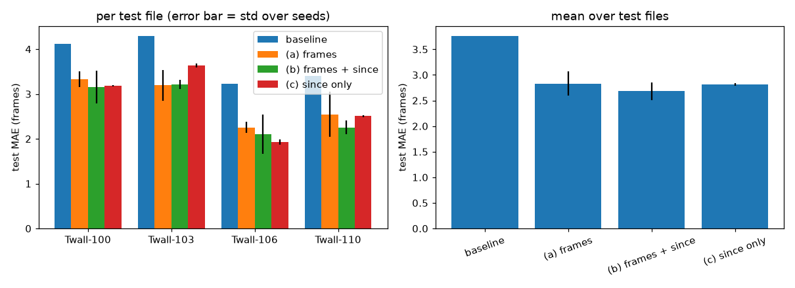

# Can a short window of frames show when the last bubble left? A feasibility check

## Question

We want to test a reward for reinforcement learning (RL) that depends on bubble departure timing.
Before building any RL, we check one thing:
does a short window of simulation frames contain enough information to tell the timing of bubble departures?

If it does, an agent can observe the timing and a timing-based reward is possible.
If it does not, no RL method can recover the timing from those frames.

## Data

- Dataset: BubbleML, subcooled pool boiling, FC-72 fluid, 2D (public S3 bucket linked from the BubbleML GitHub README).
- Files used: `Twall-100`, `Twall-103`, `Twall-106`, `Twall-110`. Each file is one simulation at a different wall temperature.
- Each file has 201 frames of 384 x 384 pixels. One frame is 1.0 non-dimensional time unit.
- The domain is x in [-6, 6] and y in [0, 12]. The heater wall is at y = 0.
- Vapor is the region where the signed distance field `dfun` is greater than 0.

## Method

### 1. Find departures (`detect_departures.py`)

1. Label each connected vapor region (a blob) in each frame.
2. A blob that touches the bottom two pixel rows is attached to the heater.
3. A departure happens at frame t when a bubble (blob of at least 200 pixels) attached at frame t-1 has its main body off the wall at frame t. The main body is the blob that overlaps the old bubble the most.
4. The main body must keep at least 30% of the old bubble's area. Otherwise the bubble collapsed or broke up, and we do not count a departure.

Departure counts and intervals (in frames):

| File | Departures | Mean interval | Median | Range |
|---|---|---|---|---|
| Twall-100 | 15 | 12.5 | 14.0 | 2-22 |
| Twall-103 | 14 | 14.0 | 14.0 | 5-21 |
| Twall-106 | 17 | 11.4 | 11.5 | 7-15 |
| Twall-110 | 17 | 10.8 | 11.0 | 5-17 |
| **Total** | **63** | | | |

Each file has fewer than the 20-50 departures we aimed for.
The four files together have 63.
Plots: `departures_Twall-100.png`, `departures_Twall-103.png`, `departures_Twall-106.png`, `departures_Twall-110.png`.

### 2. Train the probe (`probe.py`)

- Input: 5 consecutive vapor-mask frames, each shrunk to 96 x 96 pixels and stacked as channels.
- Target: the number of frames from the last input frame until the next departure.
- Samples: only windows that have both a previous and a next departure. Every model uses the same samples (173-183 per file).
- Network: three convolution layers, then global average pooling, then two linear layers. Loss: mean absolute error (MAE). Optimizer: Adam. 40 epochs.
- Test method: leave one file out. We train on three files and test on the fourth, so the test file is a wall temperature the model has not seen.
- Seeds: 5. Test data is never used to choose the epoch count or any setting.

Models compared:

| Name | Input |
|---|---|
| Baseline | None. Always predicts the mean target of the training files. |
| (a) frames | The 5 frames. |
| (b) frames + since | The 5 frames and the true number of frames since the last departure. |
| (c) since only | Only the true number of frames since the last departure. No frames. |

## Results

Test MAE in frames. Lower is better. Each cell is the mean over 5 seeds.

| Test file | Baseline | (a) frames | (b) frames + since | (c) since only |
|---|---|---|---|---|
| Twall-100 | 4.13 | 3.32 | 3.15 | 3.18 |
| Twall-103 | 4.30 | 3.20 | 3.21 | 3.63 |
| Twall-106 | 3.23 | 2.26 | 2.10 | 1.93 |
| Twall-110 | 3.40 | 2.55 | 2.25 | 2.51 |
| **Mean over files** | **3.76** | **2.83 +- 0.24** | **2.68 +- 0.18** | **2.81 +- 0.02** |

The "+-" value is the standard deviation across the 5 seeds.
For scale, the mean interval between departures is about 12 frames.



## Verdict

The frames show the timing of bubble departures.
The frames-only model (a) has a mean error of 2.83 frames, which is 25% lower than the baseline (3.76) and within seed noise of the model that also receives the true time since the last departure (b, 2.68).
By the criterion we set before the experiment, (a) is close to (b) and well below the baseline, so the idea is viable.
Two results limit how far this conclusion goes.
First, the since-only model (c) scores 2.81, the same as (a). The departures in these files are fairly regular, so knowing the time since the last departure already predicts the next one about as well as the frames do.
This means the experiment shows that the frames carry the cycle phase. It does not show that the frames carry timing information beyond what a regular cycle already gives.
Second, the data is small (about 180 samples per file, 4 files, 5 seeds), and the differences between (a), (b), and (c) are smaller than or similar to the seed-to-seed spread (0.18-0.24 frames), so we cannot rank them.

## Limitations

- **Small data.** 63 departures in total, and each file has fewer than 20.
- **Single early result was too optimistic.** A first run with one seed gave 2.55 for (a). The 5-seed mean is 2.83. Use the 5-seed numbers.
- **Detector is a heuristic.** In Twall-100 (the lowest wall temperature we used) the wall is mostly covered by merged vapor, so "one bubble leaves" is only partly well defined. We did not inspect the other three files this way. Twall-100 has two intervals of 2-3 frames that may be one event counted twice. We did not check the detector against hand-labeled departures, except by inspecting one departure (frame 44 of Twall-100) frame by frame.
- **Labels and input share one source.** The detector finds departures from the same vapor mask that the model receives. The model may learn the visual cue the detector uses, such as a bubble about to lift off.
- **Coarse time resolution.** One frame is 1.0 time unit, so timing below one frame is invisible, and the errors above are measured in whole frames of 1.0 time unit.
- **Only the vapor mask is used as input.** We did not test temperature or velocity fields, which might carry more timing information.
- **Four wall temperatures from one fluid.** The result may not carry over to other fluids, geometries, or 3D data.

## What would settle the open questions

1. Hand-label 20-30 departures and measure the detector's precision and recall.
2. Add more BubbleML files to get more departures per fold and a tighter comparison of (a), (b), and (c).
3. Test frames from other fields (temperature, velocity) and a model that must predict beyond a fixed cycle, for example by testing only on irregular intervals.

## Files

| File | Purpose |
|---|---|
| `requirements.txt` | Python packages. The comment inside explains the CUDA 12.6 build that the V100 GPU needs. |
| `download.py` | Downloads the first N HDF5 files from the BubbleML archive. |
| `inspect_file.py` | Prints the fields, shapes, and key parameters of one file. |
| `detect_departures.py` | Finds departure frames and writes `departures_<name>.npy` and `.png`. |
| `probe.py` | Trains and tests the probe models and writes `probe.png`. |
| `departures_*.npy`, `departures_*.png` | Departure frames and plots for each file. |
| `probe.png` | Probe results plot. |

Data files are in `/pub/ynagaraj/bubbleml` and are not in this repository.

## How to reproduce

```
pip install -r requirements.txt --index-url https://download.pytorch.org/whl/cu126 --extra-index-url https://pypi.org/simple
python download.py 4
for t in 100 103 106 110; do python detect_departures.py /pub/ynagaraj/bubbleml/PoolBoiling-SubCooled-FC72-2D/Twall-$t.hdf5; done
python probe.py
```
