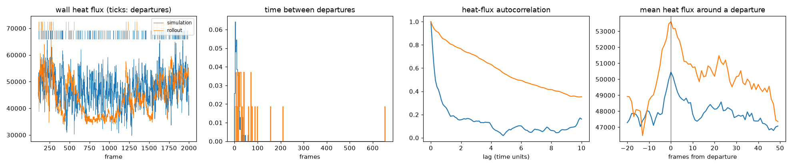

# BubbleML 2.0 results: departures and the T3 observability probe

This file reports the first results on BubbleML 2.0, the data that Bubbleformer uses.
Data facts and Bubbleformer's settings are in `analysis/T0_DATA_ALIGNMENT.md`.
The test definitions and pass criteria are in `analysis/TEST_PLAN.md` (T3).

Statement types: **measured** (from a file in this folder), **interpretation**, **recommendation**.

## 1. Departures on all 17 files

**Measured.** `scripts/detect_departures.py`, with the debounce settings frozen after T0 (`DEBOUNCE_TIME = 1.0`, `DEBOUNCE_PX = 10`).
Counts and intervals use frames 100-2000 only, because Bubbleformer skips the first 100 frames.
One frame is 0.1 time units.

| Twall | Departures | Mean interval (frames) | CV |
|---|---|---|---|
| 86 | 33 | 26.5 | 0.77 |
| 88 | 46 | 39.4 | 0.71 |
| 90 | 88 | 21.1 | 0.92 |
| 92 | 103 | 18.2 | 0.93 |
| 94 | 163 | 11.5 | 0.77 |
| 96 | 150 | 12.7 | 0.83 |
| **97 (test)** | 157 | 12.0 | 0.80 |
| 98 | 192 | 9.9 | 0.81 |
| 100 | 188 | 10.1 | 0.84 |
| 102 | 206 | 9.2 | 0.83 |
| 104 | 218 | 8.7 | 0.83 |
| 106 | 208 | 9.1 | 0.70 |
| 108 | 231 | 8.2 | 0.80 |
| 110 | 229 | 8.3 | 0.76 |
| 112 | 233 | 8.2 | 0.86 |
| 114 | 243 | 7.8 | 0.74 |
| 116 | 248 | 7.6 | 0.71 |

- The mean interval falls as Twall rises: steeply up to Twall 98, then slowly. Twall 88 is an exception (39.4 frames, against 26.5 at Twall 86).
- The CV is between 0.70 and 0.93 at every Twall. A CV of 1 is what fully random (Poisson) timing gives. The pooled departures are close to random at every wall temperature.
- The debounce removes more raw events at high Twall: 6% at Twall 86, 38% at Twall 108. The detector has not yet been validated by eye (T1), and it does the most correction where bubbles are densest.

Files: `departure_frames_Twall_<T>.npy` (frames), `departure_events_Twall_<T>.npy` (frame, x pixel), `departure_plot_Twall_<T>.png`.

## 2. T3: do Bubbleformer's 5 input frames predict the time to the next departure?

### Method

`scripts/departure_probe_v2.py`. All settings were fixed before the run.

- **Input**: 5 frames x 4 fields (`dfun`, `temperature`, `velx`, `vely`), the same fields Bubbleformer uses. Each field is averaged over 4 x 4 cells, from 512 x 512 to 128 x 128.
- **Target**: frames from the last input frame to the next departure, from any nucleation site.
- **Split**: Bubbleformer's own. Train on the 16 training files, test on Twall 97.
- **Windows**: frames 100-2000. A window is kept only if it has a previous and a next departure. Training uses every 5th window (5,811 windows), because neighbouring windows share 4 of 5 frames. Testing uses every window (1,881).
- **Training**: 4 convolution layers, absolute-error loss, Adam, 10 epochs, 5 seeds.
- **Irregular windows**: windows inside an interval more than 1 std from the mean training interval (582 of 1,881 test windows).
- **Median baseline**: added after the run by `scripts/departure_probe_median_baseline_v2.py`, for the reason given under the results.

### Results

**Measured.** Test MAE in frames on Twall 97. Models: mean ± sample std over 5 seeds.

| Model | All windows | Irregular windows |
|---|---|---|
| (a) mean only (training mean, 11.18) | 7.04 | 10.32 |
| (a') median only (training median, 7.00) | **6.52** | 12.27 |
| (b) time since last departure only | 6.56 ± 0.04 | 12.50 ± 0.10 |
| (c) 5 frames | 6.46 ± 0.47 | 9.45 ± 0.96 |
| (d) 5 frames + time since last departure | 6.55 ± 0.30 | 9.69 ± 1.74 |
| Best constant on the test file itself (not a fair baseline) | 6.49 | - |

For scale: the mean interval at Twall 97 is 12.0 frames.

Pass criteria from `analysis/TEST_PLAN.md`, with sd = 0.47 (seed std of model c):

| Criterion | Result | Values |
|---|---|---|
| 1. (c) beats (a) by more than 2 sd | **FAIL** | 7.04 - 6.46 = 0.58, less than 0.95 |
| 2. \|(d) - (c)\| within 1 sd | PASS | 0.09, less than 0.47 |
| 3. On irregular windows, (c) beats (b) by more than 2 sd | PASS | 12.50 - 9.45 = 3.05, more than 0.95 |

**T3 fails**, because the plan requires all three criteria.

### Effect of the GPU on these numbers

**Measured.** A rerun on an NVIDIA A30 gave different values for the two frame models, with the same verdict:

| Model | First run: all / irregular | A30 rerun: all / irregular |
|---|---|---|
| (c) 5 frames | 6.46 ± 0.47 / 9.45 ± 0.96 | 6.46 ± 0.56 / 9.59 ± 1.05 |
| (d) 5 frames + time | 6.55 ± 0.30 / 9.69 ± 1.74 | 6.38 ± 0.15 / 10.26 ± 1.68 |

- On the A30, repeated runs are identical, and the code before and after the renaming gives identical results. So the code is deterministic on one GPU type, and the renaming changed nothing.
- The first run was probably on a V100, which was the GPU at the start of this work. The GPU of that run was not recorded. Different GPUs can use different kernels, which changes rounding during training. This is the likely cause, not a proven one.
- The criteria give the same results on both: 1 fails, 2 and 3 pass. The difference between (c) and (d) changes sign between the two runs, which confirms that it is noise.
- The tables above report the first run. The A30 output is in `departure_probe_v2_a30_gpu.log`.

### The median baseline changes the reading

A model trained with absolute-error loss that learns nothing useful predicts the median of the training targets.
The waiting times are skewed, so the median (7.00) has a lower absolute error than the mean (11.18).
The fair "no information" baseline is therefore the median, not the mean.
The test plan named only the mean baseline. This was a mistake in the plan.

Against the median:

- **All windows.** The frames model (6.46 ± 0.47) equals the median baseline (6.52). It also equals the best constant for the test file (6.49). The frames give no measurable information about the time to the next departure.
- **The true clock gives none either.** The time-only model (6.56) also equals the median baseline.
- **Criteria 2 and 3 do not show information.** Criterion 2 passes because neither the frames nor the clock helps. Criterion 3 passes because the irregular windows are mostly inside long intervals, where the targets are large. On those windows, a model that predicts larger values beats the time-only model. The frames model (9.45) beats the median (12.27) but not the mean baseline (10.32). This is a flaw in how criterion 3 was defined.

## 3. What this means

**Interpretation.**

1. At the pooled level (departures from any nucleation site; the metadata lists 15 sites at Twall 97 and up to 35 at higher Twall), the next departure is close to unpredictable. The CV is near 1, and neither the frames nor the true time since the last departure beats a constant guess.
2. This does not show that the frames hide a clock. It shows that, at this level, there is almost no clock to hide. A process with random (memoryless) timing has no phase.
3. For the RL plan, this is mixed news:
   - **Good**: if the pooled timing is memoryless, a Markovian 5-frame emulator does not need hidden memory to reproduce it. The worry behind T3 matters less at this level.
   - **Bad**: the pooled timing statistic mostly measures the departure **rate** and the **shape** of the waiting-time distribution. Those are what R3 can reward. "Departing at the right moment" is not learnable from this target.
4. The per-site timing may still have a clock. Each site waits `nucWaitTime = 0.4` (4 frames) and then grows a bubble over about 150 frames. This probe does not test that.

## 4. Limits of this result

- **One test file** (Twall 97), as in Bubbleformer's split. No other held-out Twall was tested.
- **Detector not validated** (T1). Every target depends on it.
- **128 x 128 input**, not Bubbleformer's 512 x 512. Small bubbles near the wall may be lost by the averaging.
- **Pooled target only.** A per-site target ("time until this site's next departure") might be predictable even though the pooled one is not.
- **Short training**: 10 epochs on 5,811 windows. A larger model might find information this one missed. The seed spread (0.47) is large compared with the differences being tested.

## 5. Recommendations

1. Validate the detector (T1) before drawing conclusions from any departure-based number.
2. Repeat T3 with a **per-site** target: for each nucleation site, frames until that site's next departure, using the input around that site.
3. Fix the T3 criteria: use the median as the no-information baseline, and define irregular windows so that both short and long intervals are included.
4. Revisit R3: with near-random pooled timing, a reward on the waiting-time distribution (rate and shape) is meaningful. A reward on the phase of individual departures is not, at the pooled level.

## Files

| File | Contents |
|---|---|
| `departure_probe_v2.log` | Full printed output of `scripts/departure_probe_v2.py`, first run. It uses older labels (`sd`). |
| `departure_probe_v2_a30_gpu.log` | The same probe, rerun on an NVIDIA A30. |
| `departure_probe_v2.json` | Per-seed MAE values and criteria results. |
| `departure_probe_v2.png` | Bar plots of the results (mean baseline only). |
| `departure_probe_median_baseline_v2.log` | Output of `scripts/departure_probe_median_baseline_v2.py`. |
| `departure_frames_Twall_<T>.npy`, `departure_events_Twall_<T>.npy`, `departure_plot_Twall_<T>.png` | Departures per file (section 1). |

## 6. T6: does the published Bubbleformer-S get the timing wrong? (Twall 97)

### Method

`scripts/compare_rollout_timing_v2.py` (added in commit `0a54581`).

- Model: the published checkpoint `Bubbleformer-S-PB-Subcooled.ckpt` from Hugging Face (`hpcforge/Bubbleformer`), with model code from `github.com/HPCForge/Bubbleformer` at commit `8d1dade`.
- Start: simulation frames 100-104 of Twall 97 (Bubbleformer's validation file, not used in its training).
- Rollout: 379 steps of 5 frames, each prediction fed back as the next input, giving frames 105-1999 (189.5 time units). One rollout; the model is deterministic.
- Comparison: the same statistics on the simulation over the same frames. For scale: the simulation's second half against its first half (noise floor), and the simulations at Twall 96 and 98 (what a 1-degree error looks like).
- Heat flux: a proxy with Bubbleformer's formula on the 128 x 128 fields. Fair for comparison, not the exact heat flux.
- Cost: the rollout took 47 s on one V100. The whole script took about 25 minutes, mostly statistics and reads from `/pub`.

**Change to the script.** The original loaded the checkpoint with `torch.load(..., weights_only=False)`, which can run any code stored in the file. The permission system blocked that. The script now uses a restricted unpickler: it allows only torch's own safe list plus the 10 classes this checkpoint needs (omegaconf configs and plain containers). PyTorch's built-in `weights_only=True` could not be used, because it cannot fill the `defaultdict` in this checkpoint.

### Results

**Measured.** From `rollout_timing_Twall_97.md`. "Distance" and "difference" rows compare with the Twall 97 simulation; 0 is a perfect match. Interval distance and histogram distance use the Wasserstein-1 distance: the average shift needed to make one distribution match the other. RMS means root mean square.

| Statistic | Rollout | Simulation 97 | Noise floor (sim halves) | Simulation 96 | Simulation 98 |
|---|---|---|---|---|---|
| Departures | **28** | 157 | 82 (one half) | 149 | 191 |
| Departures per 100 frames | **1.48** | 8.28 | 8.65 | 7.86 | 10.1 |
| Mean interval (frames) | **68.3** | 12.0 | 11.5 | 12.8 | 9.86 |
| Interval coefficient of variation | 1.82 | 0.80 | 0.87 | 0.82 | 0.81 |
| Interval distance to simulation (frames) | **46.3** | 0 | 2.08 | 1.01 | 2.14 |
| Heat-flux mean | 44,200 | 47,300 | 47,200 | 46,400 | 49,700 |
| Heat-flux histogram distance to simulation | 3,100 | 0 | 409 | 909 | 2,480 |
| Heat-flux autocorrelation RMS difference to simulation | **0.461** | 0 | 0.119 | 0.069 | 0.113 |
| Heat flux around departures, RMS difference to simulation | 2,340 | 0 | 840 | 1,340 | 2,130 |
| Vapor fraction | 0.0225 | 0.0263 | 0.0278 | 0.0258 | 0.0288 |

**Measured, extra check** (not in the script; computed from the saved vapor masks, every 10th frame):

| Frames | Wall coverage (sim / rollout) | Bubbles in domain (sim / rollout) | Bubbles on the wall (sim / rollout) |
|---|---|---|---|
| 105-404 | 0.42 / 0.34 | 19.9 / 28.9 | 11.6 / 9.6 |
| 405-704 | 0.44 / 0.31 | 20.2 / 15.0 | 10.9 / 7.3 |
| 705-1004 | 0.44 / 0.36 | 21.2 / 11.1 | 12.3 / 7.1 |
| 1005-1304 | 0.46 / 0.33 | 23.1 / 15.5 | 13.1 / 6.3 |
| 1305-1604 | 0.45 / 0.30 | 22.6 / 14.7 | 14.3 / 7.1 |
| 1605-1904 | 0.41 / 0.23 | 25.2 / 14.8 | 13.5 / 6.2 |

### What it means

- **The baseline gets the timing wrong, by far more than the noise.** The rollout has 5.6 times fewer departures than the simulation. Its interval distribution is 46 frames from the simulation's (Wasserstein-1 distance), against a noise floor of 2 frames and a 1-degree Twall change of 1-2 frames. Its heat-flux autocorrelation is about 4 times farther from the simulation than the noise floor.
- **This is not a detector artifact.** The bubble counts in the extra check do not use the departure detector. After about frame 400, the rollout has about half as many bubbles on the wall and in the domain.
- **The model loses boiling activity, not bubble shape.** The rollout's bubbles do not form a vapor layer on the wall: wall coverage is lower than in the simulation. Its heat flux is still lower, so the fluid near the wall must be warmer in the rollout (interpretation; temperature was not checked directly).
- **The heat-flux mean is close** (44,200 against 47,300; 7% low). A reward on the snapshot mean alone would see a small error. The timing statistics see a large one. This is the motivation the project needs for R3.

**T6 pass criterion 2** (the baseline's R3 error at the held-out Twall is above the noise floor for at least one statistic): **passes**, for the interval distance, the autocorrelation, and the heat flux around departures.
**T6 pass criterion 1** (reproduce the reported 10-frame accuracy): **not tested**.

### Limits

- One rollout, from one start state. The plan asks for 5 start states.
- The detector is not validated (T1), and predicted bubbles may have softer edges than simulated ones. The detector-free bubble counts support the result.
- The heat flux is a proxy on 128 x 128 fields.
- Bubbleformer's reported accuracy was not reproduced, so a setup error (for example in the input normalization or the conditioning values) cannot be ruled out. Already in frames 105-404 the rollout differs from the simulation: more bubbles in the domain (28.9 against 19.9) and less wall coverage (0.34 against 0.42). Checking the one-step and 10-frame accuracy against the paper's values is the next step before trusting this result.

## 7. GPU tests A-D and a check against the Bubbleformer paper (job 59689741)

`scripts/run_gpu_tests_v2.sbatch` ran tests A-D on one V100 in 64 minutes. All four tests finished. Tables: `accuracy_Twall_97.md`, `rollout_starts_Twall_97.md`, `dwell_times_Twall_97.md`, `window_sweep_Twall_97.md`. Logs: `logs/`.

### Results

**Measured.**

- **A. Short-term accuracy (20 start frames).** Bubbleformer-S is about 3 times better than persistence (repeat the last input frame). Frame 1, relative L2: velx 0.121 against 0.332, vely 0.097 against 0.263. Vapor IoU: 0.875 against 0.756. Frames 6-10: vapor IoU 0.761 against 0.291.
- **D. Rollouts from 4 more start frames (250, 500, 750, 995; 1,000 frames each).** Every rollout loses activity: 1.4-2.8 departures per 100 frames, against 7.0-8.5 in the simulation over the same frames. Interval W1: 23-49 frames. The mean heat flux is similar or higher (54,000 against 47,100 from start 995).
- **B. Quiet and active dwell times** (heat flux smoothed over 10 frames, threshold = simulation median). Simulation: mean quiet dwell 17.7 frames, longest 107. Rollouts: mean 28-70, longest up to 621. Quiet-dwell W1 to the simulation: 9-39 frames, against a noise floor of 3.2. The Markov gap (max |P(2L) - P(L)^2|) is small and noisy for both the simulation and the rollouts.
- **C. Window sweep** (frames until the next departure, 3 seeds). Median baseline 6.55. Window 1: 5.98; 2: 6.36; 5: 6.38; 10: 6.26; 20: 6.45 frames. A longer window does not help.

### Check against the paper

**Source:** the checkpoint's saved settings, and Bubbleformer (arXiv 2507.21244), Table 8 and Section 4.2.

- **Settings match.** The checkpoint uses the same 4 fields in the same order, a 5-frame window, start frame 100, no normalization, full 512 x 512 resolution, and the same 9 conditioning values in the same order. Twall 97 is its validation file. It trained for 250 epochs. It has 28.9M parameters (the paper reports 29.5M).
- **Short-term error.** The paper reports no 1-10 frame forecast error for subcooled pool boiling, so test A cannot be compared with it directly.
- **Long rollout, Table 8 (Bubbleformer-S, FC-72, 97 C).** Heat-flux KL divergence: paper 1.06; ours 0.19 over 200 frames and 0.85 over the full rollout, which is consistent. Relative vapor-volume error: paper 2.66; ours 0.15-0.25, about 10 times lower. This difference is not explained: the paper gives no horizon or start frame for Table 8, and the Bubbleformer repository has no evaluation script. Our KL uses the 128 x 128 heat-flux proxy, not the paper's full-resolution heat flux.
- **Bubbleformer-L.** The paper reports that Bubbleformer-L is much better than S on subcooled boiling (vapor-volume error 0.38 against 2.66 at 97 C).

### What it means

**Interpretation.**

- The setup is correct, so the T6 stall comes from the model, not from a setup error. The stall happens from every start frame.
- The failure is a rate problem: the rollout is too quiet and stays quiet too long. Longer windows do not help, and the quiet/active switching shows no clear memory. A timing reward on the departure rate, waiting times and dwell times targets this failure directly. A memory head is an ablation, not the main fix.
- The paper's vapor-volume error for S is much worse than ours, and the paper reports that L is much better. Before RL, check whether Bubbleformer-L also stalls, at Twall 97 and at Twall 107 (also not used in training).

### Limits

- The departure detector is still not checked by hand (T1).
- The heat flux is a proxy on 128 x 128 fields.
- One fluid, one held-out wall temperature.

## 8. Bubbleformer-L, and a second held-out wall temperature (Twall 107)

Jobs 59694715 and 59694717, one V100 each, 24 minutes in total. Script: `scripts/run_bubbleformer_l_v2.sbatch`. Tables: `accuracy_Twall_97_L.md`, `rollout_timing_Twall_97_L.md`, `rollout_timing_Twall_107_L.md`, `rollout_timing_Twall_107_S.md`. Twall 107 is not in Bubbleformer's training or validation lists.

**Settings check.** The L checkpoint uses the same data settings as S: the same 4 fields, a 5-frame window, start frame 100, no normalization, the same 9 conditioning values, and 32 training files. It has embedding size 768, 12 heads, 115.3M parameters (the paper reports 115.8M), and 250 epochs of training.

### Results

**Measured.** Departures per 100 frames, frames 105-1999:

| Model | Twall 97 (simulation 8.28) | Twall 107 (simulation 11.7) |
|---|---|---|
| Bubbleformer-S | 1.48 | 7.18 |
| Bubbleformer-L | 2.22 | 1.42 |

Distance from the simulation, with the noise floor (simulation second half against first half) in brackets:

| Statistic | S, Twall 97 | L, Twall 97 | S, Twall 107 | L, Twall 107 |
|---|---|---|---|---|
| Interval W1 (frames) | 46.3 (2.08) | 29.9 (2.08) | **5.41 (1.73)** | 58.1 (1.73) |
| Heat-flux histogram W1 | 3,100 (409) | 8,790 (409) | **590 (1,590)** | 17,700 (1,590) |
| Heat-flux autocorrelation, RMS | 0.461 (0.119) | 0.577 (0.119) | **0.057 (0.066)** | 0.779 (0.066) |
| Heat flux around departures, RMS | 2,340 (840) | 7,990 (840) | **1,220 (1,560)** | 15,500 (1,560) |
| Vapor fraction (simulation) | 0.0225 (0.0263) | 0.0137 (0.0263) | 0.0366 (0.035) | 0.0138 (0.035) |

**L short-term accuracy at Twall 97** (5 start frames) is the same as S: frame-1 relative L2 for velx is 0.120 against 0.332 for persistence, and the vapor IoU is 0.883 against 0.787.

### What it means

**Interpretation.**

- **L also loses bubble activity, by more than S.** At both wall temperatures, L makes 3.7-8 times too few departures, and its vapor fraction is about half of the simulation's. This disagrees with the paper, which reports that L keeps vapor volume much better than S (error 0.38 against 2.66). We have not found the cause. The settings of both checkpoints match the paper's configuration.
- **S at Twall 107 is the clearest case for a timing reward.** Its heat-flux histogram, autocorrelation and event response are all within the noise floor of the simulation, but it makes 39% too few departures (7.18 against 11.7 per 100 frames). Its interval W1 is 3 times the noise floor. A snapshot reward would pass this rollout. A departure-rate reward would not.
- **Recommendation:** keep Bubbleformer-S as the backbone. It is better than L in these rollouts, and it is 4 times cheaper to run. Use Twall 107 as a second held-out test, because it isolates the timing error from the snapshot errors.

### Limits

- One rollout per model and wall temperature, from start frame 100.
- The departure detector is still not checked by hand (T1).
- The heat flux is a proxy on 128 x 128 fields.
