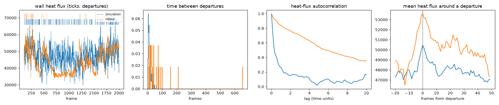

# BubbleML 2.0 results: departures and the T3 observability probe

This file reports the first results on BubbleML 2.0, the data that Bubbleformer uses.
Data facts and Bubbleformer's settings are in `analysis/T0_DATA_ALIGNMENT.md`.
The test definitions and pass criteria are in `analysis/TEST_PLAN.md` (T3).

Statement types: **measured** (from a file in this folder), **interpretation**, **recommendation**.

## 1. Departures on all 17 files

**Measured.** `scripts/detect_departures.py`, with the debounce settings frozen after T0 (`DEBOUNCE_TIME = 1.0`, `DEBOUNCE_PX = 10`).
Counts and intervals use frames 100-2000 only, because Bubbleformer skips the first 100 frames.
One frame is 0.1 time units.

| Twall | Departures | Mean interval (frames) | CV |
|---|---|---|---|
| 86 | 33 | 26.5 | 0.77 |
| 88 | 46 | 39.4 | 0.71 |
| 90 | 88 | 21.1 | 0.92 |
| 92 | 103 | 18.2 | 0.93 |
| 94 | 163 | 11.5 | 0.77 |
| 96 | 150 | 12.7 | 0.83 |
| **97 (test)** | 157 | 12.0 | 0.80 |
| 98 | 192 | 9.9 | 0.81 |
| 100 | 188 | 10.1 | 0.84 |
| 102 | 206 | 9.2 | 0.83 |
| 104 | 218 | 8.7 | 0.83 |
| 106 | 208 | 9.1 | 0.70 |
| 108 | 231 | 8.2 | 0.80 |
| 110 | 229 | 8.3 | 0.76 |
| 112 | 233 | 8.2 | 0.86 |
| 114 | 243 | 7.8 | 0.74 |
| 116 | 248 | 7.6 | 0.71 |

- The mean interval falls as Twall rises: steeply up to Twall 98, then slowly. Twall 88 is an exception (39.4 frames, against 26.5 at Twall 86).
- The CV is between 0.70 and 0.93 at every Twall. A CV of 1 is what fully random (Poisson) timing gives. The pooled departures are close to random at every wall temperature.
- The debounce removes more raw events at high Twall: 6% at Twall 86, 38% at Twall 108. The detector has not yet been validated by eye (T1), and it does the most correction where bubbles are densest.

Files: `departures_Twall_<T>.npy` (frames), `departures_Twall_<T>_events.npy` (frame, x pixel), `departures_Twall_<T>.png`.

## 2. T3: do Bubbleformer's 5 input frames predict the time to the next departure?

### Method

`scripts/probe_v2.py`. All settings were fixed before the run.

- **Input**: 5 frames x 4 fields (`dfun`, `temperature`, `velx`, `vely`), the same fields Bubbleformer uses. Each field is averaged over 4 x 4 cells, from 512 x 512 to 128 x 128.
- **Target**: frames from the last input frame to the next departure, from any nucleation site.
- **Split**: Bubbleformer's own. Train on the 16 training files, test on Twall 97.
- **Windows**: frames 100-2000. A window is kept only if it has a previous and a next departure. Training uses every 5th window (5,811 windows), because neighbouring windows share 4 of 5 frames. Testing uses every window (1,881).
- **Training**: 4 convolution layers, absolute-error loss, Adam, 10 epochs, 5 seeds.
- **Irregular windows**: windows inside an interval more than 1 std from the mean training interval (582 of 1,881 test windows).
- **Median baseline**: added after the run by `scripts/median_baseline_v2.py`, for the reason given under the results.

### Results

**Measured.** Test MAE in frames on Twall 97. Models: mean ± sample std over 5 seeds.

| Model | All windows | Irregular windows |
|---|---|---|
| (a) mean only (training mean, 11.18) | 7.04 | 10.32 |
| (a') median only (training median, 7.00) | **6.52** | 12.27 |
| (b) time since last departure only | 6.56 ± 0.04 | 12.50 ± 0.10 |
| (c) 5 frames | 6.46 ± 0.47 | 9.45 ± 0.96 |
| (d) 5 frames + time since last departure | 6.55 ± 0.30 | 9.69 ± 1.74 |
| Best constant on the test file itself (not a fair baseline) | 6.49 | - |

For scale: the mean interval at Twall 97 is 12.0 frames.

Pass criteria from `analysis/TEST_PLAN.md`, with sd = 0.47 (seed std of model c):

| Criterion | Result | Values |
|---|---|---|
| 1. (c) beats (a) by more than 2 sd | **FAIL** | 7.04 - 6.46 = 0.58, less than 0.95 |
| 2. \|(d) - (c)\| within 1 sd | PASS | 0.09, less than 0.47 |
| 3. On irregular windows, (c) beats (b) by more than 2 sd | PASS | 12.50 - 9.45 = 3.05, more than 0.95 |

**T3 fails**, because the plan requires all three criteria.

### The median baseline changes the reading

A model trained with absolute-error loss that learns nothing useful predicts the median of the training targets.
The waiting times are skewed, so the median (7.00) has a lower absolute error than the mean (11.18).
The fair "no information" baseline is therefore the median, not the mean.
The test plan named only the mean baseline. This was a mistake in the plan.

Against the median:

- **All windows.** The frames model (6.46 ± 0.47) equals the median baseline (6.52). It also equals the best constant for the test file (6.49). The frames give no measurable information about the time to the next departure.
- **The true clock gives none either.** The time-only model (6.56) also equals the median baseline.
- **Criteria 2 and 3 do not show information.** Criterion 2 passes because neither the frames nor the clock helps. Criterion 3 passes because the irregular windows are mostly inside long intervals, where the targets are large. On those windows, a model that predicts larger values beats the time-only model. The frames model (9.45) beats the median (12.27) but not the mean baseline (10.32). This is a flaw in how criterion 3 was defined.

## 3. What this means

**Interpretation.**

1. At the pooled level (departures from any nucleation site; the metadata lists 15 sites at Twall 97 and up to 35 at higher Twall), the next departure is close to unpredictable. The CV is near 1, and neither the frames nor the true time since the last departure beats a constant guess.
2. This does not show that the frames hide a clock. It shows that, at this level, there is almost no clock to hide. A process with random (memoryless) timing has no phase.
3. For the RL plan, this is mixed news:
   - **Good**: if the pooled timing is memoryless, a Markovian 5-frame emulator does not need hidden memory to reproduce it. The worry behind T3 matters less at this level.
   - **Bad**: the pooled timing statistic mostly measures the departure **rate** and the **shape** of the waiting-time distribution. Those are what R3 can reward. "Departing at the right moment" is not learnable from this target.
4. The per-site timing may still have a clock. Each site waits `nucWaitTime = 0.4` (4 frames) and then grows a bubble over about 150 frames. This probe does not test that.

## 4. Limits of this result

- **One test file** (Twall 97), as in Bubbleformer's split. No other held-out Twall was tested.
- **Detector not validated** (T1). Every target depends on it.
- **128 x 128 input**, not Bubbleformer's 512 x 512. Small bubbles near the wall may be lost by the averaging.
- **Pooled target only.** A per-site target ("time until this site's next departure") might be predictable even though the pooled one is not.
- **Short training**: 10 epochs on 5,811 windows. A larger model might find information this one missed. The seed spread (0.47) is large compared with the differences being tested.

## 5. Recommendations

1. Validate the detector (T1) before drawing conclusions from any departure-based number.
2. Repeat T3 with a **per-site** target: for each nucleation site, frames until that site's next departure, using the input around that site.
3. Fix the T3 criteria: use the median as the no-information baseline, and define irregular windows so that both short and long intervals are included.
4. Revisit R3: with near-random pooled timing, a reward on the waiting-time distribution (rate and shape) is meaningful. A reward on the phase of individual departures is not, at the pooled level.

## Files

| File | Contents |
|---|---|
| `probe_v2.log` | Full printed output of `scripts/probe_v2.py`. |
| `probe_v2.json` | Per-seed MAE values and criteria results. |
| `probe_v2.png` | Bar plots of the results (mean baseline only). |
| `median_baseline_v2.log` | Output of `scripts/median_baseline_v2.py`. |
| `departures_Twall_<T>*` | Departures per file (section 1). |

## 6. T6: does the published Bubbleformer-S get the timing wrong? (Twall 97)

### Method

`scripts/rollout_timing_v2.py` (added in commit `0a54581`).

- Model: the published checkpoint `Bubbleformer-S-PB-Subcooled.ckpt` from Hugging Face (`hpcforge/Bubbleformer`), with model code from `github.com/HPCForge/Bubbleformer` at commit `8d1dade`.
- Start: simulation frames 100-104 of Twall 97 (Bubbleformer's validation file, not used in its training).
- Rollout: 379 steps of 5 frames, each prediction fed back as the next input, giving frames 105-1999 (189.5 time units). One rollout; the model is deterministic.
- Comparison: the same statistics on the simulation over the same frames. For scale: the simulation's second half against its first half (noise floor), and the simulations at Twall 96 and 98 (what a 1-degree error looks like).
- Heat flux: a proxy with Bubbleformer's formula on the 128 x 128 fields. Fair for comparison, not the exact heat flux.
- Cost: the rollout took 47 s on one V100. The whole script took about 25 minutes, mostly statistics and reads from `/pub`.

**Change to the script.** The original loaded the checkpoint with `torch.load(..., weights_only=False)`, which can run any code stored in the file. The permission system blocked that. The script now uses a restricted unpickler: it allows only torch's own safe list plus the 10 classes this checkpoint needs (omegaconf configs and plain containers). PyTorch's built-in `weights_only=True` could not be used, because it cannot fill the `defaultdict` in this checkpoint.

### Results

**Measured.** From `rollout_timing_Twall_97.md`. "To sim" columns are distances from the Twall 97 simulation; 0 is a perfect match.

| Statistic | Rollout | Simulation 97 | Noise floor (sim halves) | Simulation 96 | Simulation 98 |
|---|---|---|---|---|---|
| Departures | **28** | 157 | 82 (one half) | 149 | 191 |
| Departures per 100 frames | **1.48** | 8.28 | 8.65 | 7.86 | 10.1 |
| Mean interval (frames) | **68.3** | 12.0 | 11.5 | 12.8 | 9.86 |
| Interval CV | 1.82 | 0.80 | 0.87 | 0.82 | 0.81 |
| Interval W1 to sim (frames) | **46.3** | 0 | 2.08 | 1.01 | 2.14 |
| Heat-flux mean | 44,200 | 47,300 | 47,200 | 46,400 | 49,700 |
| Heat-flux histogram W1 to sim | 3,100 | 0 | 409 | 909 | 2,480 |
| Heat-flux autocorrelation RMS diff | **0.461** | 0 | 0.119 | 0.069 | 0.113 |
| Event-response RMS diff | 2,340 | 0 | 840 | 1,340 | 2,130 |
| Vapor fraction | 0.0225 | 0.0263 | 0.0278 | 0.0258 | 0.0288 |

**Measured, extra check** (not in the script; computed from the saved vapor masks, every 10th frame):

| Frames | Wall coverage (sim / rollout) | Bubbles in domain (sim / rollout) | Bubbles on the wall (sim / rollout) |
|---|---|---|---|
| 105-404 | 0.42 / 0.34 | 19.9 / 28.9 | 11.6 / 9.6 |
| 405-704 | 0.44 / 0.31 | 20.2 / 15.0 | 10.9 / 7.3 |
| 705-1004 | 0.44 / 0.36 | 21.2 / 11.1 | 12.3 / 7.1 |
| 1005-1304 | 0.46 / 0.33 | 23.1 / 15.5 | 13.1 / 6.3 |
| 1305-1604 | 0.45 / 0.30 | 22.6 / 14.7 | 14.3 / 7.1 |
| 1605-1904 | 0.41 / 0.23 | 25.2 / 14.8 | 13.5 / 6.2 |

### What it means

- **The baseline gets the timing wrong, by far more than the noise.** The rollout has 5.6 times fewer departures than the simulation. Its interval distribution is 46 frames (W1) from the simulation's, against a noise floor of 2 frames and a 1-degree Twall change of 1-2 frames. Its heat-flux autocorrelation is about 4 times farther from the simulation than the noise floor.
- **This is not a detector artifact.** The bubble counts in the extra check do not use the departure detector. After about frame 400, the rollout has about half as many bubbles on the wall and in the domain.
- **The model loses boiling activity, not bubble shape.** The rollout's bubbles do not form a vapor layer on the wall: wall coverage is lower than in the simulation. Its heat flux is still lower, so the fluid near the wall must be warmer in the rollout (interpretation; temperature was not checked directly).
- **The heat-flux mean is close** (44,200 against 47,300; 7% low). A reward on the snapshot mean alone would see a small error. The timing statistics see a large one. This is the motivation the project needs for R3.

**T6 pass criterion 2** (the baseline's R3 error at the held-out Twall is above the noise floor for at least one statistic): **passes**, for the interval W1, the autocorrelation, and the event response.
**T6 pass criterion 1** (reproduce the reported 10-frame accuracy): **not tested**.

### Limits

- One rollout, from one start state. The plan asks for 5 start states.
- The detector is not validated (T1), and predicted bubbles may have softer edges than simulated ones. The detector-free bubble counts support the result.
- The heat flux is a proxy on 128 x 128 fields.
- Bubbleformer's reported accuracy was not reproduced, so a setup error (for example in the input normalization or the conditioning values) cannot be ruled out. Already in frames 105-404 the rollout differs from the simulation: more bubbles in the domain (28.9 against 19.9) and less wall coverage (0.34 against 0.42). Checking the one-step and 10-frame accuracy against the paper's values is the next step before trusting this result.
